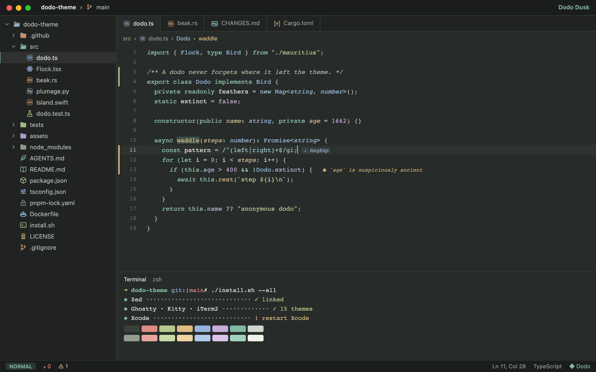
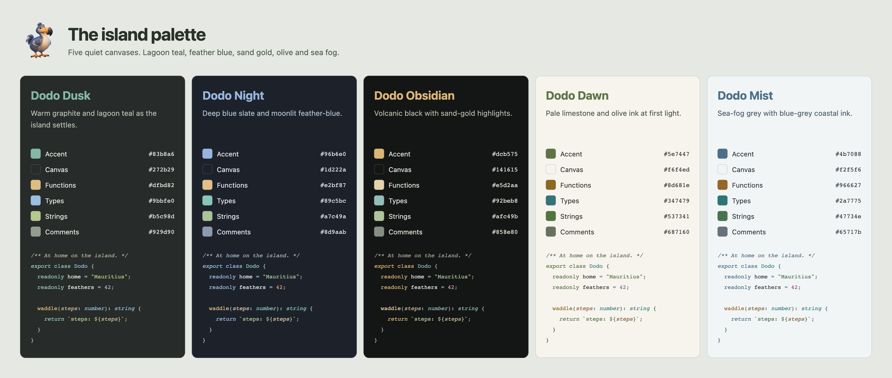
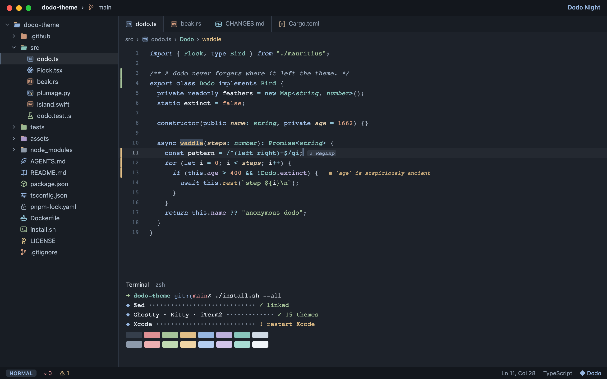
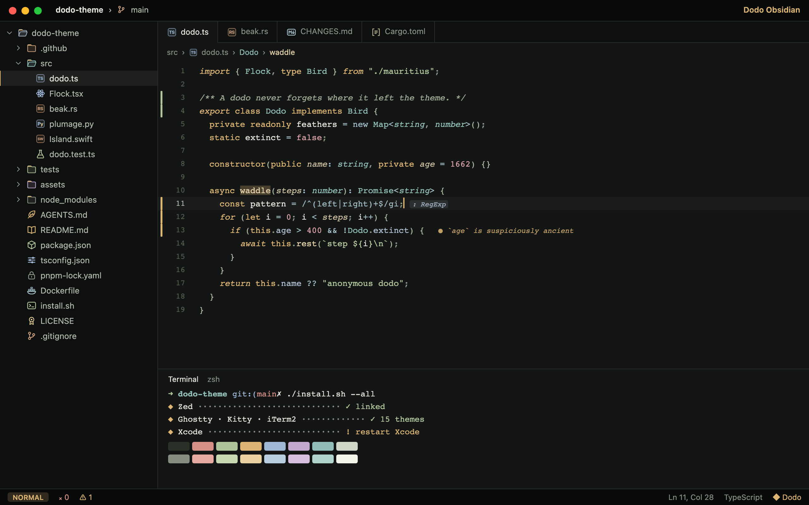
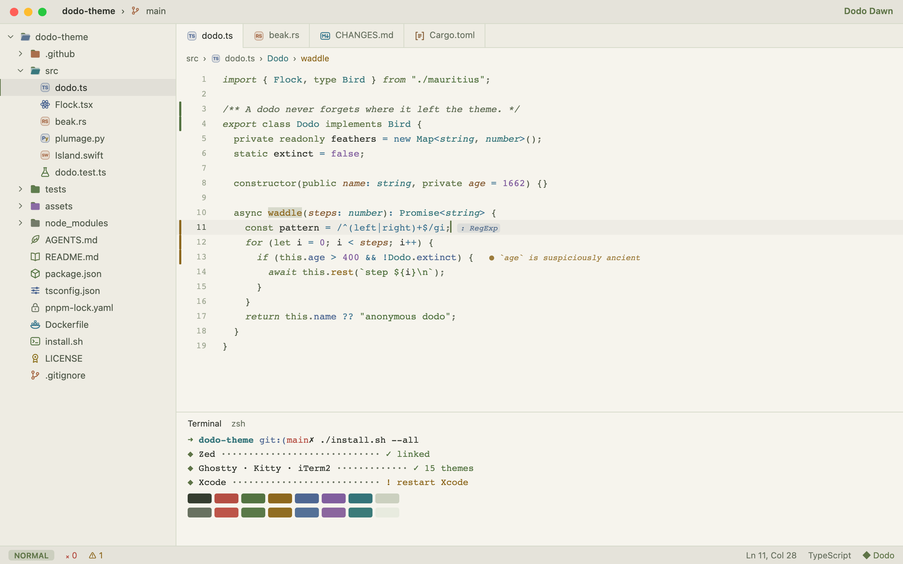
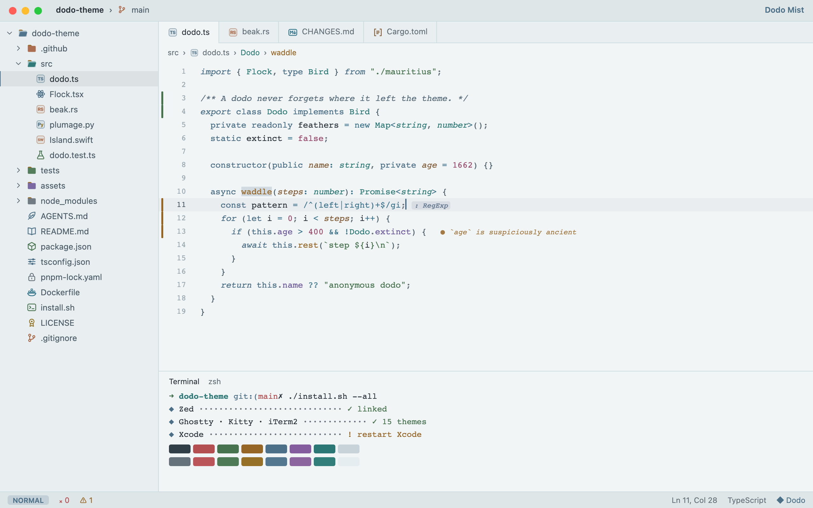
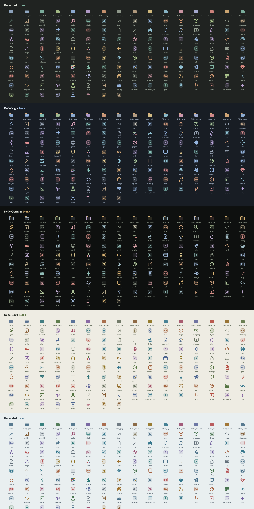
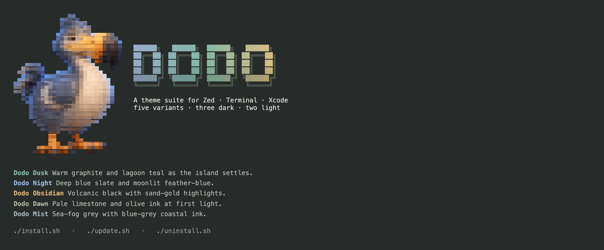

<p align="center">
  
</p>

<h1 align="center">Dodo</h1>

<p align="center">
  <b>A matching theme suite for Zed, your terminal, and Xcode.</b><br>
  Island colours, quiet surfaces · five variants · three dark, two light · hand-drawn file icons
</p>

<p align="center">
  
</p>

---

## What's new

Dodo's refreshed palettes take their identity from its bird and island:
lagoon teal, feather blue, sand gold, olive and sea fog.

- **Five refreshed palettes** across Zed, all seven terminal apps and
  Xcode, with softer syntax colours and clearer comments and punctuation.
- **Original file icons**: a feather for `AGENTS.md`, `AGENT.md`,
  `.mcp.json` and `llms.txt`, and a small bird for Dodo config files.
  Vendor-specific branding and icon treatments have been removed.
- **Blinking block cursors** in all five Terminal.app profiles, coloured
  with each variant's own accent.
- **Checked readability**: foreground text exceeds 11:1 contrast and every
  syntax colour reaches 4.5:1 against its editor canvas, including comments.
- **Fresh previews and installer colours**, including the palette overview
  below and a feather-blue → lagoon-teal → gold terminal wordmark.

Already using Dodo? [Run the updater](#update) to bring the refreshed themes
into your installed apps. See [the changelog](CHANGELOG.md) for the update
history.

## The flock

Each variant is a quiet grey canvas with a hint of warmth or coolness. The
colour lives in your code, not in a tint across the whole screen. Every
variant builds its syntax colours around its own accent, so they share a
family resemblance but aren't just the same theme at different brightness.

| | Variant | Mood | Accent | Canvas |
|---|---|---|---|---|
| 🌆 | **Dodo Dusk** | Warm graphite as the island settles | lagoon teal `#83b8a6` | `#272b29` |
| 🌌 | **Dodo Night** | Deep blue slate after sundown | feather blue `#96b6e0` | `#1d222a` |
| 🌋 | **Dodo Obsidian** | Volcanic black with quiet mineral hues | sand gold `#dcb575` | `#141615` |
| 🌅 | **Dodo Dawn** | Pale limestone and olive ink at first light | canopy olive `#5e7447` | `#f6f4ed` |
| 🌫️ | **Dodo Mist** | Sea-fog grey with coastal ink | blue-grey `#4b7088` | `#f2f5f6` |

<p align="center"></p>

<table>
  <tr>
    <td></td>
    <td></td>
  </tr>
  <tr>
    <td></td>
    <td></td>
  </tr>
</table>

These are Zed-style previews rendered from the generated themes and icons.

### Colours from the bird and its island

| Colour source | Used for |
|---|---|
| slate-blue **feathers** | folders, properties, links |
| honey-gold **beak** | functions, in every variant |
| Mauritius **lagoon** teal | Dusk's cursor and keywords; types in other variants |
| cream **belly** | the foreground text |
| island **canopy** olive | Dawn's cursor and keywords; foliage greens for strings |
| cinnamon **eye** | parameters (in italics) |

## What's inside

| | |
|---|---|
| **Zed** | 5 themes plus 5 matching **icon themes**: 168 hand-tuned 16px SVGs per variant (840 in total), covering 684 file-name and extension associations, with tinted folders for 132 well-known directory names |
| **Terminal** | Terminal.app (blinking block cursors) · iTerm2 (with light/dark **auto-switching** profiles) · Ghostty · Kitty · Alacritty · WezTerm · Warp |
| **Xcode** | 5 `.xccolortheme`s. Your own symbols are shown in full colour and Apple's SDK symbols in a softer shade, so your code stands out |
| **Scripts** | `install.sh` · `update.sh` (with optional automatic updates) · `uninstall.sh` |

<p align="center"></p>

### The details

Ideas borrowed from the best themes around, then adapted:

- **Neutral overlays** (from Rosé Pine). Hover, active and selected states are
  tints of the text colour, not the accent, so the UI never takes on a colour
  cast.
- **Dimmed punctuation** (from Tokyo Night). Brackets and commas fade back so
  identifiers stand out. Brackets are one step brighter than delimiters.
- **Italics with a purpose** (from Catppuccin). Comments, parameters, `self`/`this`,
  control flow (`return`, `await`, `if`, `import`) and built-in types are
  italic. Plain keywords are not.
- **Restrained highlights** (from Vesper). Obsidian pairs sand-gold keywords
  with wheat-coloured functions and softer mineral colours for the rest.
- **Layered mineral surfaces**. The title bar and status bar sit darkest,
  then panels, then the editor, with popovers floating just above it.
- **Thought-out extras**: different colours for read and write highlights,
  rainbow-bracket accents, vim/helix mode pills, diff hunks, conflict
  markers, collaborator cursors, inlay hints in a soft pill,
  and translucent scrollbars and minimap.
- **Checked contrast**: body text is at least 11:1 on every variant, and
  syntax colours, including comments and punctuation, reach 4.5:1 against
  the editor canvas. Each build prints a WCAG report
  (`python3 src/build.py --check`).
- **Icons that vary a little per theme**: language badges are tinted
  rounded squares (the radius and fill weight change per variant). Folders
  are feather-blue with a small tab in the variant's accent colour. Obsidian
  uses outlined folders. `AGENTS.md` gets an accent-coloured feather;
  Dodo config files get a small bird.

## Install

```bash
git clone https://github.com/chrisnicholson30/dodo-theme ~/.dodo-theme
~/.dodo-theme/install.sh
```

or in one line (this clones into `~/.dodo-theme` for you):

```bash
bash -c "$(curl -fsSL https://raw.githubusercontent.com/chrisnicholson30/dodo-theme/main/install.sh)"
```

<p align="center"></p>

The installer:

1. **detects** which of Zed, Terminal.app, iTerm2, Ghostty, Kitty, Alacritty,
   WezTerm, Warp and Xcode you have;
2. **asks before doing anything**, and lets you pick individual apps;
3. **links** the Zed extension and the terminal themes back to this folder
   (copying only where an app requires it), so updates arrive in place;
4. asks for your **favourite dark and light variants**, and can switch Dodo
   on in Zed, Ghostty and Terminal.app straight away. Zed and Ghostty then
   follow your system's light/dark setting. Every edit it makes is marked
   `added by dodo-theme` and is reversed by `uninstall.sh`. If you have
   already set a theme yourself, it leaves it alone;
5. offers **automatic updates**.

```text
install.sh [--zed] [--terminal] [--xcode] [--all] [--force]
           [-y|--yes] [--dark=Dusk|Night|Obsidian] [--light=Dawn|Mist]
           [--apply|--no-apply] [--auto-update[=daily|weekly|hourly]|--no-auto-update]
           [--list] [-q|--quiet]
```

### Turning it on by hand

| App | How |
|---|---|
| Zed | `⌘K ⌘T` → *Dodo …*, and *icon theme selector: toggle* → *Dodo … Icons*. Or in `settings.json`:<br>`"theme": { "mode": "system", "light": "Dodo Dawn", "dark": "Dodo Dusk" },`<br>`"icon_theme": { "mode": "system", "light": "Dodo Dawn Icons", "dark": "Dodo Dusk Icons" }` |
| Ghostty | `theme = light:Dodo Dawn,dark:Dodo Dusk` |
| iTerm2 | Settings › Profiles › **Dodo Auto (Dusk ⇄ Dawn)** (follows the macOS appearance), or any single variant |
| Terminal.app | Settings › Profiles › *Dodo Dusk* › **Default** |
| Kitty | `kitten themes --reload-in=all "Dodo Dusk"` |
| Alacritty | `general.import = ["~/.config/alacritty/themes/dodo/dodo-dusk.toml"]` |
| WezTerm | `config.color_scheme = "Dodo Dusk"` |
| Warp | Settings › Appearance › Themes › *Dodo Dusk* |
| Xcode | restart Xcode → Settings › Themes › *Dodo Dusk* |

## Update

```bash
~/.dodo-theme/update.sh            # pull, then refresh every installed app
~/.dodo-theme/update.sh --check    # is anything new? (exit code 10 = yes)
```

Zed and the text-based terminals are **symlinked** to this folder, so a
`git pull` updates them immediately (Zed reloads the theme while it's
running). Copies that apps require (Xcode, iTerm2) are refreshed.
Terminal.app profiles are re-imported only when they actually changed. The
updater fast-forwards only: it never overwrites local edits or rewrites your
history, and it tells you if something is in the way.

For this palette refresh, the updater also re-imports the changed
Terminal.app profiles. Select your updated Dodo profile when opening a new
window. If you imported profiles by hand, import the matching file from
[`terminal/terminal-app`](terminal/terminal-app) again. You can also set an
existing profile's cursor in **Settings › Profiles › your Dodo profile ›
Text › Cursor › Block**, with **Blink cursor** enabled.

Restart Xcode to load its refreshed colours. For apps that don't reload
themes automatically, reopen the app or reselect your Dodo theme.

### Automatic updates

```bash
~/.dodo-theme/update.sh --auto daily    # or weekly / hourly
~/.dodo-theme/update.sh --auto status
~/.dodo-theme/update.sh --auto off
```

This uses a **launchd** agent on macOS, a **systemd user timer** on Linux, and
**cron** as a fallback. It runs quietly, logs to
`~/.local/state/dodo-theme/update.log`, and shows a desktop notification
when a new version arrives.

## Uninstall

```bash
~/.dodo-theme/uninstall.sh          # shows exactly what will go, then asks
~/.dodo-theme/uninstall.sh --purge  # …and deletes the Dodo folder too
```

It removes only what the installer recorded: its own symlinks and copies,
the lines it marked, and the update schedule. It also puts back any file
the installer had moved aside. The banner turns grey, because the dodo is
going extinct again.

## Make it yours

The editor, icon and terminal exports share one palette source:

```bash
python3 -m pip install pillow # Python 3.12+; only needed for building themes
$EDITOR src/palette.py       # change a hex value
python3 src/build.py --check # regenerate Zed + icons + 7 terminals + Xcode, then check contrast
```

README previews also need **Pygments** and **Playwright for Node.js**, with
its Chromium browser installed. With those available, run:

```bash
python3 src/preview.py && node src/shoot.cjs
```

This refreshes all five editor previews, the icon sheet, the palette
overview and both terminal banners. `fonttools` is only needed if you
rebuild the badge lettering with `src/extract_glyphs.py`.

```
src/palette.py      the five variants: UI greys, accent, syntax, ANSI, icon colours
src/gen_zed.py      Zed theme family (every style key Zed currently supports)
src/gen_icons.py    the 16px icon system + file and folder associations
src/gen_terminal.py Terminal.app · iTerm2 · Ghostty · Kitty · Alacritty · WezTerm · Warp
src/gen_xcode.py    Xcode themes
src/gen_art.py      the half-block pixel dodo + gradient wordmark used by the scripts
src/preview.py      editor previews, icon sheet, palette overview and terminal banners
src/shoot.cjs       render those previews to PNG with Playwright
lib/dodo.sh         shared shell library (bash 3.2-safe, so it runs on stock macOS)
```

## Credits

- The dodo mascot is by the author.
- The badge lettering is built from outlines of **Inter Display** by Rasmus
  Andersson (SIL Open Font License 1.1).
- Theme details take cues from Catppuccin, Rosé Pine, Tokyo Night, Vesper
  and Kanagawa; Dodo's palettes draw on its bird and island setting.

MIT © Chris Nicholson
